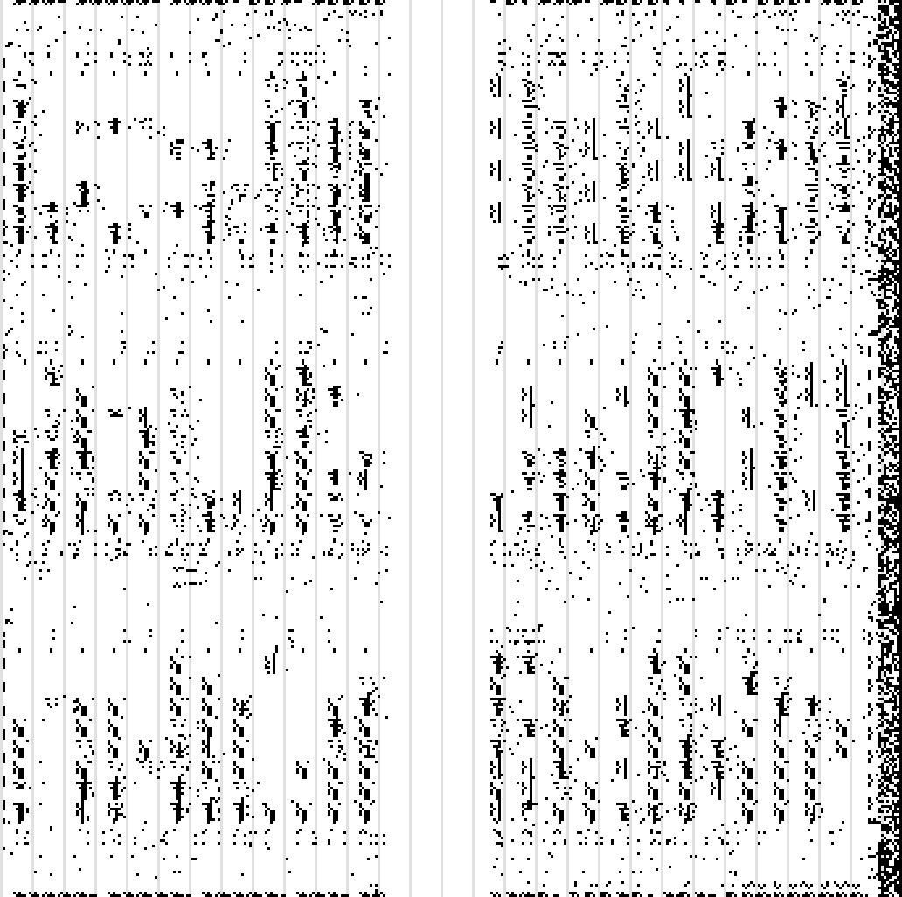

# Hyper Neo Geo 64: FPGA Network

> @TODO: Tidy it up, raw notes

## POF Container

- Not documented
- Contains in little endian:
    - Magic
    - Packet count
    - 16 bits tag
    - 32 bits length
    - data
- It's not encrypted
- The first 40 bits are not FLEX 10K data
    - Data starts at `01 00 00 67 CE`
    - Data is 118 000 bits long
    - EPC1 settings before

- A frame:

| Frame bit | Byte.bit     | Content             |
|-----------|--------------|---------------------|
| 0         | 0.0          | Start bit, always 0 |
| 1-334     |              | Data, section 5     |
| 335-342   | 41.7 to 42.6 | CRC-8, bit 7 first  |
| 343       | 42.7         | Stop bit, always 1  |

- By bruteforce, polynomial of the CRC is `x^8 + x^4 + 1`

## Map

## Sources

- https://mil.ufl.edu/4712/docs/dsf10k.pdf
- https://edg.uchicago.edu/~tang/capmap/dsconf.pdf
- https://community.altera.com/discussions/fpga-device/pof-file-format-specification/280939
