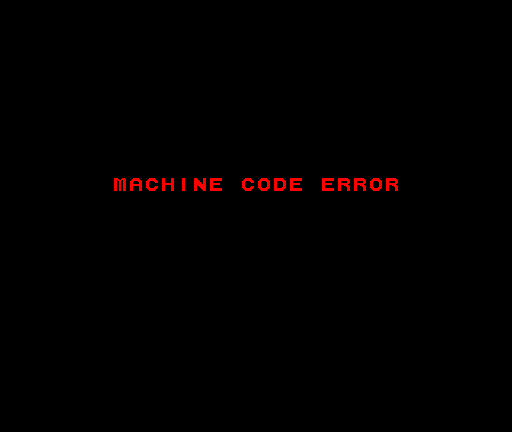
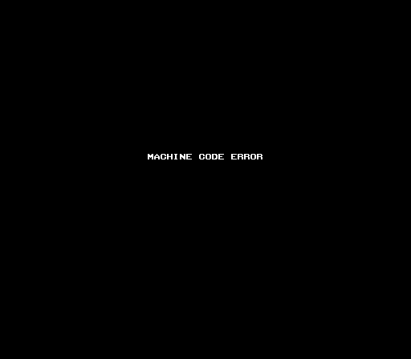

# IOMCU

> @TODO: More research needed

> Only by behavior analysis and disasm and what's done in MAME

> STATUS: Quite understood!

Toshiba TMP87PH40AN, TLCS-870 arch, 8 Mhz, 32Kb, SDIP64

ROM:
- Sha1: `5b742e8a0bbf4c0ae4f4398d34c7058fb24acc92`
- MAME File: `tmp87ph40an.bin`
- Disasm: `unidasm tmp87ph40an.bin -arch tlcs870 -basepc 0xc000 -skip 0x4000`

## Pinout

From the datasheet:
```
                      +------( )-----+
        A8 / P70  1 --|              |-- 64 VDD / VCC
        A9 / P71  2 --|              |-- 63 P67 / AIN7 / A7
       A10 / P72  3 --|              |-- 62 P66 / AIN6 / A6
       A11 / P73  4 --|              |-- 61 P65 / AIN5 / A5
       A12 / P74  5 --|              |-- 60 P64 / AIN4 / A4
       A13 / P75  6 --|              |-- 59 P63 / AIN3 / A3
       A14 / P76  7 --|              |-- 58 P62 / AIN2 / A2
             P77  8 --|              |-- 57 P61 / AIN1 / A1
        D0 / P00  9 --|              |-- 56 P60 / AIN0 / A0
        D1 / P01 10 --|              |-- 55 VAREF
        D2 / P02 11 --|              |-- 54 VASS
        D3 / P03 12 --|              |-- 53 P54
        D4 / P04 13 --|              |-- 52 P53
        D5 / P05 14 --|              |-- 51 P52 / ~PWM / ~PDO
        D6 / P06 15 --|              |-- 50 P51 / INT4/TC4
        D7 / P07 16 --|              |-- 49 P50 / INT3/TC3
     ~INT0 / P10 17 --|              |-- 48 P47 / SO2
      INT1 / P11 18 --|              |-- 47 P46 / SI2
  INT2/TC1 / P12 19 --|              |-- 46 P45 / SCK2
~CE / ~DVO / P13 20 --|              |-- 45 P44 / SO1
~OE / ~PPG / P14 21 --|              |-- 44 P43 / SI1
       TC2 / P15 22 --|              |-- 43 P42 / SCK1
             P16 23 --|              |-- 42 P41
             P17 24 --|              |-- 41 P40
 INT5/STOP / P20 25 --|              |-- 40 P37
      VPP / TEST 26 --|              |-- 39 P36
      XTIN / P21 27 --|              |-- 38 P35
     XTOUT / P22 28 --|              |-- 37 P34
           RESET 29 --|              |-- 36 P33
             XIN 30 --|              |-- 35 P32
            XOUT 31 --|              |-- 34 P31
       GND / VSS 32 --|              |-- 33 P30
                      +--------------+
```

## Dual port RAM

The CPU talks to the IOMCU through 2 KB RAM shared by both CPUs
(called DP here). Mapped at `0xBF808000` one byte per address.

CPU writes a command at DP `0x000` and its parameter
at DP `0x001`, kicks the MCU, then reads the status at DP `0x002` and
the inputs.

## Kick

Basically, kick is how the CPU tells the MCU to run the command in DP. Write
a value to the upper half of `0xBF7021C4` (Warning: as 16 bit store).

MCU sets status to `0x02`, reads DP `0x000` and `0x001`,
runs the command and writes the final status to DP `0x002`.

- Poll DP `0x002`, there is no interrupt for the answer apparently ?
- After boot, kick only when the status is `0x00` or `0x01`
- Rewrite DP `0x000` before every kick, the MCU never clears it and
  runs whatever is there

## Boot

From MAME, same as what `roadedge`, `buriki` and `fatfurwa` do:
- Until the MCU is configured, only act on status `0x03` and `0x04`. DP `0x002`
   reads `0x00` at power on and a stale `0x00` for a few us after the first kick
- At status `0x03`, clear DP `0x002` and kick once with command `0x00`. A
   normal boot should have already did it, so the BIOS handshake kicks at status `0x03`
- Do not write to DP until status is `0x04`, the MCU tests the DP and
   locks up for good on any write (only a board reset recovers). It
   takes about 6s in MAME
- At status `0x04`, write `8, 8, 0, 0` to DP `0x200-0x203` (digital,
   analog, output 1, output 2 block sizes) then send command `0x06`. Games
   send command `0x0A` instead
- Send command `0x00` every frame

## Inputs

After each command with status `0x00` or `0x01`, read the player words. Big-endian
16 bit, active high:
| DP            | Player |
|---------------|--------|
| `0x008-0x009` | P1     |
| `0x00A-0x00B` | P2     |

Bits 0-7 and 15 are the stick and buttons (wiring depends on the board io),
bit 14 is Start.

## Commands

List of commands for the IO MCU:

| Command | Parameter     | Does what ?                                                                                                                     |
|---------|---------------|---------------------------------------------------------------------------------------------------------------------------------|
| `0x00`  | none          | Refresh inputs, must be sent every frame                                                                                        |
| `0x01`  | none          | Invalid, status `0x0F` detail `0x02`                                                                                            |
| `0x02`  | `!= 0`        | Split coin counters coin 2 pulses for  counter 2, else counter 1                                                                |
| `0x03`  | channel `0-7` | Exchange data, then status `0x05` with the raw ADC value of that channel. No mask, `> 7` reads past the channels into MCU RAM ? |
| `0x04`  | `!= 0`        | Remap DP `0x006` on, else `~IN4 & 0x3F`                                                                                         |
| `0x05`  | none          | Set the 24 byte remap table from DP `0x200`                                                                                     |
| `0x06`  | none          | Set block sizes from DP `0x200-0x203` and send at status 4                                                                      |
| `0x07`  | `!= 0`        | Game drives the coin counters MCU by default                                                                                    |
| `0x08`  | `!= 0`        | IN6 7 alarm on                                                                                                                  |
| `0x09`  | none          | Set alarm and period from DP `0x200-0x203`                                                                                      |
| `0x0A`  | none          | Set full 64 byte configuration from DP `0x200`                                                                                  |
| `0x0B`  | bit 0         | EEPROM job clear reloads DP `0x600` from EEPROM and set writes it. Status is 0x09 if one is running                             |
| `0x0C`  | `!= 0`        | Analog block on                                                                                                                 |
| `0x0D`  | none          | Set the 24-byte calibration table from DP `0x200`                                                                               |
| `0x0E`  | none          | Exchange, detail `0x10` (firmware version 1.0)                                                                                  |
| `0x0F`  | none          | Exchange only                                                                                                                   |

Other CMD returns `0x0F`

## Status codes

Read from DP `0x002`:
| Status         | What it is?                                                                                    |
|----------------|------------------------------------------------------------------------------------------------|
| `0x00`         | Done, read the inputs                                                                          |
| `0x01`         | Done like `0x00`, plus a coin, service or test event. Read inputs.                             |
| `0x02`         | Busy, never kick                                                                               |
| `0x03`         | Boot, waiting for the first kick                                                               |
| `0x04`         | Boot done send command `0x06`                                                                  |
| `0x05`         | Answer to command `0x03`, detail is the raw ADC value                                          |
| `0x09`         | Command `0x0B` refused, so an EEPROM job is running                                            |
| `0x0F`         | Error? Detail `0x01` and `0x02` refreshed the inputs, `0x05` and `0x06` mean the MCU is dead ? |
| `0x55`, `0xAA` | Not a status, the MCU's DP test pattern during its boot                                        |

## Pseudo code

MCU FW TLDR:
```python
def mcu_boot():
   # Fails with 0x0F/0x05 and halts if it fails
   mcu_ram_test()
   dp[STATUS] = 0x03
   # K?ick runs command through isr_kick
   wait_kick()
   # Writes 0x55/0xAA
   # If CPU writes, return 0x0F/0x06
   dp_test_pattern()
   # dp[0x600..0x6FF]
   eeprom_check_and_copy()
   # Ready to handle things, wants cmd 0x06
   dp[STATUS] = 0x04

def mcu_main():
   mcu_boot()
   while True:
      read_adc()
      # Pg 2 mailbox + IRQ
      post_events()
      # Copy of dp[0x000..0x03F] in RAM
      build_image()
      eeprom_job_step()
      coin_pulses_and_lamps()

# 1 ms tick
# Debouncing coin + service + test
def isr_tick():
   read_digital_ports()

# INT0 the CPU kick
def isr_kick():
   # busy wait for things
   dp[STATUS], dp[DETAIL] = 0x02, 0
   cmd, param = dp[0x000], dp[0x001]
   status, detail = run_command(cmd, param)
   # CPU clear dp[0x402]
   ack_coin_event()
   # No error wait for next cmd
   if status == 0x00:
      status, detail = pending_event() or (status, detail)
   dp[STATUS], dp[DETAIL] = status, detail

def pending_event():
   if alarm: return 0x0F, 0x01
   if test: return 0x01, 0x01
   if service: return 0x01, 0x02
   if coin: return 0x01, 0x03
   return None

def run_command(cmd, param):
   # dp[0x004] analog block out output blocks in
   exchange()
   if cmd == 0x01 or cmd >= 0x10: return 0x0F, 0x02
   # No mask
   if cmd == 0x03: return 0x05, adc_raw[param]
   if cmd == 0x02: coin_split = param != 0
   if cmd == 0x04: remap_dp6 = param != 0
   if cmd == 0x05: remap_table = dp[0x200:0x218]
   if cmd == 0x06: block_sizes = dp[0x200:0x204]
   if cmd == 0x07: game_drives_coins = param != 0
   if cmd == 0x08: alarm_on = param != 0
   if cmd == 0x09: alarm_cfg = dp[0x200:0x204]
   if cmd == 0x0A: config = dp[0x200:0x240]
   if cmd == 0x0B:
      if eeprom_busy: return 0x09, 0
      # dp[0x600] <-> EEPROM
      eeprom_start(write=param & 1)
   if cmd == 0x0C: calibrated_analog = param != 0
   if cmd == 0x0D: calib_table = dp[0x200:0x218]
   # Return version 1.0?
   if cmd == 0x0E: return 0x00, 0x10
   # Unknown cmd!
   return 0x00, 0
```

## Machine code error

---





---

The Infamous(tm) "MACHINE CODE ERROR".

Simply, games read DP `0x600` and compare it with their board type:
- `0x1` : fighting
- `0x2` : wheel
- `0x3` : gun

The byte is the byte 0 of the IO EEPROM.
Mismatch the game hangs on `MACHINE CODE ERROR`.
A blank EEPROM gives 0 which no game accepts of course.

## Misc

Random bits of trivia:
- Only $C000-$FFFF is the ROM, code ends at 0xD46F
- String id: `64Bit I/O Controller Ver 1.0 1997.06.29(C)SNK`
